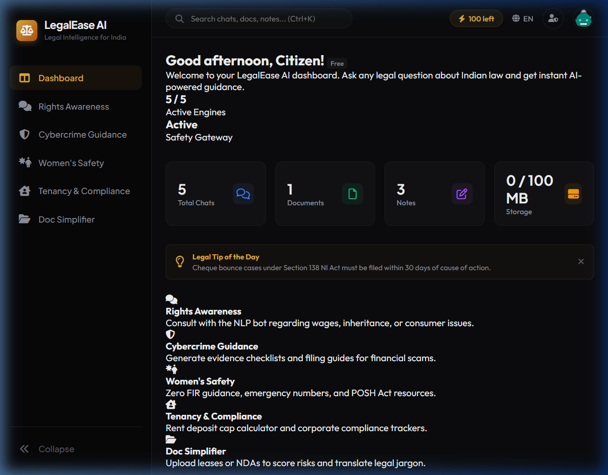
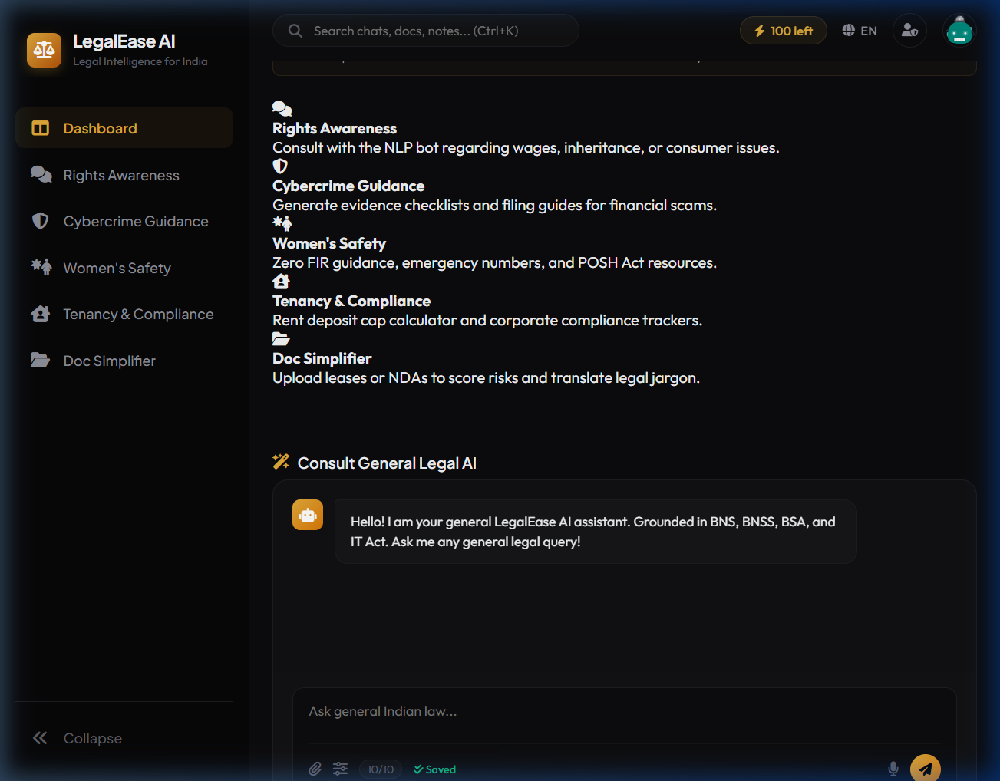

# Law Chat Bot Vibe

> **AI-powered Legal Intelligence for Indian Citizens** — Ask any legal question, understand your rights, and get instant guidance powered by NLP and RAG.

---

## Screenshots

### Dashboard


### Chat & Features Panel


---

## Features

| Module | Description |
|--------|-------------|
| **Rights Awareness** | NLP-powered chatbot using TF-IDF + cosine similarity over an Indian legal corpus |
| **Cybercrime Guidance** | Step-by-step evidence checklists for UPI fraud, phishing, identity theft and extortion |
| **Women's Safety** | POSH Act 2013 guidance, Zero FIR assistance, and emergency helpline interception |
| **Tenancy and Compliance** | Security deposit calculator under the Model Tenancy Act 2021 |
| **Doc Simplifier** | Contract risk analyzer — scores clauses as Red / Amber / Green |
| **Safety Gateway** | Auto PII redaction (Aadhaar/PAN/Phone), disclaimer injection, danger detection |

---

## Tech Stack

- **Backend:** Python, Flask
- **NLP / ML:** NLTK, scikit-learn (TF-IDF + Cosine Similarity)
- **Frontend:** HTML, CSS, JavaScript
- **Data:** Custom Indian Legal Corpus (JSON)

---

## Installation and Setup

### 1. Clone the Repository
```bash
git clone https://github.com/your-username/law-chat-bot-vibe.git
cd law-chat-bot-vibe
```

### 2. Install Dependencies
```bash
python -m pip install -r requirements.txt
```

### 3. Run the App
```bash
python app.py
```

### 4. Open in Browser
```
http://127.0.0.1:5000
```

---

## API Endpoints

| Endpoint | Method | Description |
|----------|--------|-------------|
| `/` | GET | Main dashboard |
| `/chat` | POST | Core legal RAG chatbot |
| `/api/chat_module` | POST | Module-specific chatbot (cybercrime, safety, tenancy) |
| `/api/cybercrime` | POST | Cybercrime evidence checklist generator |
| `/api/tenant_calculator` | POST | Security deposit legal cap calculator |
| `/api/simplify` | POST | Contract/document risk analyzer |
| `/api/safety_logs` | GET | View session safety gateway logs |

---

## Safety and Ethics

- **PII Redaction** — Automatically masks Aadhaar, PAN, and phone numbers
- **Danger Detection** — Intercepts threat/violence keywords and shows emergency helplines
- **Disclaimer Injection** — Every response includes a legal disclaimer
- **Outcome Protection** — Blocks case outcome predictions

---

## Legal Disclaimer

Law Chat Bot Vibe is an AI legal information assistant, not a lawyer. All information is for educational and awareness purposes under Indian law only. For formal legal advice, please consult a registered legal professional.

---

## License

MIT License — see [LICENSE](LICENSE) for details.
